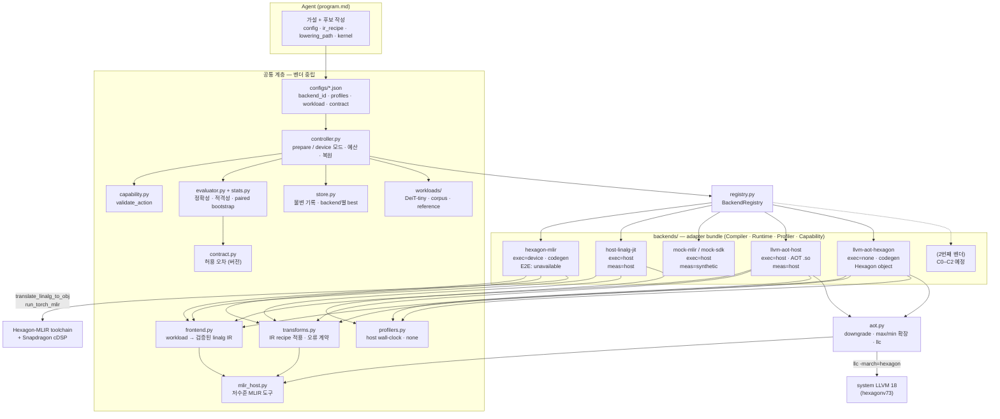
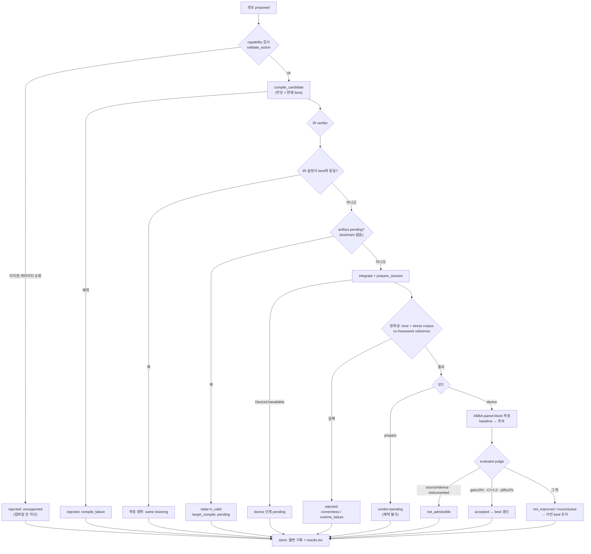
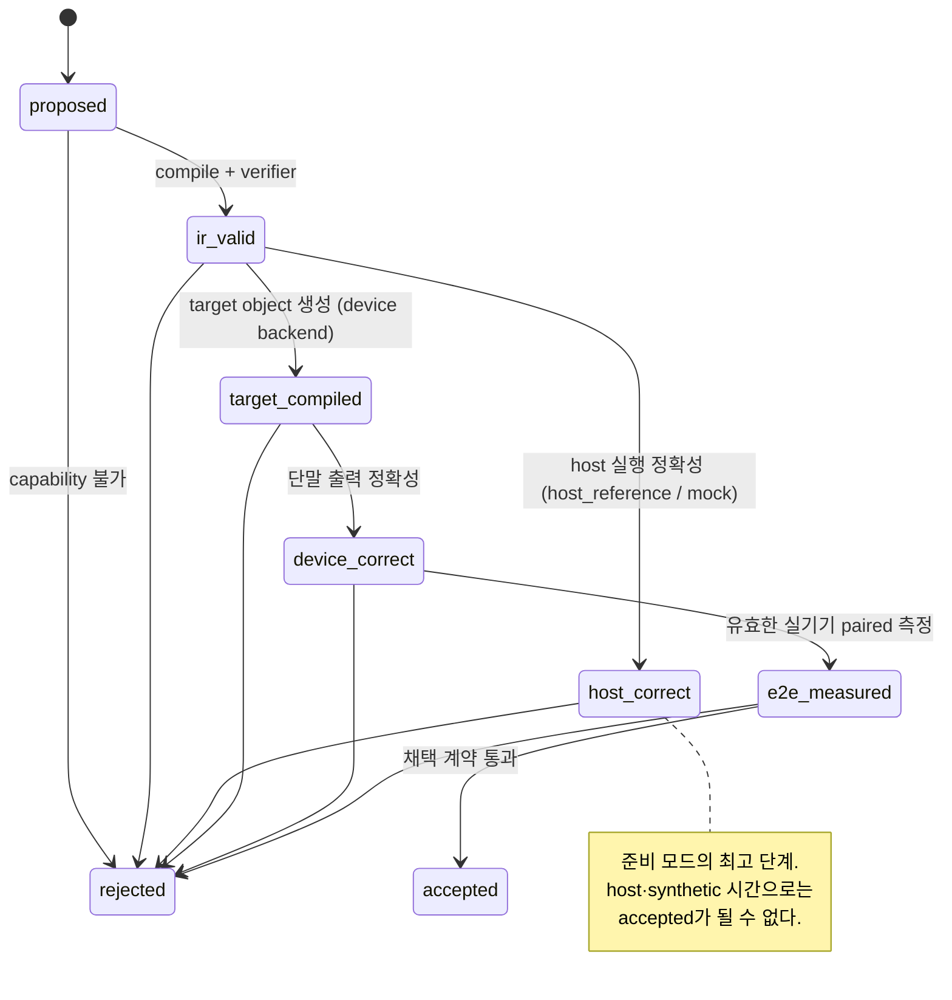
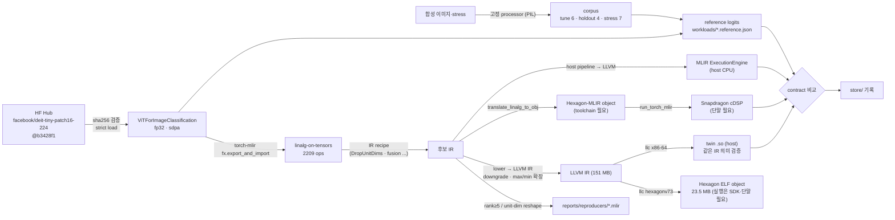
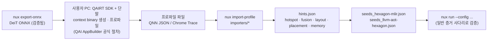

# nux — 멀티 벤더 모바일 NPU 자동 최적화 시스템 (초기 프로젝트)

**nux**는 여러 모바일 벤더의 컴파일러·런타임 경로를 adapter 교체로 연결하는 공통 자동 최적화 계층이다.
`mobile_compiler_autokernel_plan_v0_3.md`(기획서 v0.3)의 **준비 단계(A0–A4)**를 구현했다.
공통 계층(controller·후보/결과 schema·정확성 계약·채택 정책·실험 저장소)과
벤더별 adapter bundle(compiler·runtime·profiler·capability)을 분리했다.
첫 백엔드는 Hexagon-MLIR이고, 첫 검증 모델은 **DeiT-tiny**(`facebook/deit-tiny-patch16-224`,
non-distilled)다. 기존 `../autokernel-hexagon/`(RMSNorm 커널 루프)와는 별도 프로젝트다.

> **현재 상태 (2026-11-18)**: 실행 환경에 Snapdragon 단말, Hexagon SDK, Hexagon-MLIR 빌드가
> 없다. 그래서 이 저장소의 모든 결과는 **준비 모드**에서 나온 것이다. `accepted` 후보와
> NPU·E2E 지연 수치는 **하나도 없다.** host 시간은 host CPU 시간이고 성능 근거가 아니다.

## 1. 구조

### 1.1 전체 디렉토리

```
nux/                                   # 프로젝트 루트 (demos/nux)
├── README.md                          # 이 문서
├── program.md                         # 에이전트 지침 (수정 경계·실험 절차·결과 해석)
├── requirements.txt                   # host 준비 단계 의존성 (torch, torch-mlir 20261101, transformers ...)
│
├── nux/                               # Python 패키지 (python -m nux)
│   ├── __init__.py                    # SCHEMA_VERSION
│   ├── __main__.py                    # CLI: env / capabilities / workload / corpus / ir / smoke / run / status
│   │
│   │   ── 공통 계층 (벤더 이름 금지: tests/test_core.py가 검사) ──
│   ├── schema.py                      # Candidate, Measurement, CandidateRecord, 상태 사다리(State), 실패 분류(Failure)
│   ├── capability.py                  # CapabilityManifest, ActionSpec(support × validation), validate_action
│   ├── adapters.py                    # CompilerAdapter / RuntimeAdapter / ProfilerAdapter / AdapterBundle / Artifact
│   ├── registry.py                    # BackendRegistry: backend_id → bundle, profile 호환성 검사
│   ├── controller.py                  # 실험 루프: prepare / device 모드, ABBA paired 측정, 예산, best 복원
│   ├── evaluator.py                   # 정확성 검사, 측정 적격성, 채택 판정 (읽기 전용 규칙)
│   ├── stats.py                       # paired block 통계, bootstrap CI, Policy(3% / CI>1.0 / p95 2%)
│   ├── contract.py                    # 정확성 계약 (deit-tiny-fp32-logits-v0, toy-fp32-v0)
│   ├── store.py                       # 불변 기록, backend별 best 격리, cache key, results.tsv
│   ├── frontend.py                    # 공유 front end: workload → 검증된 linalg IR (프로세스 캐시). backend는 여기서만 baseline IR을 얻는다
│   ├── transforms.py                  # 공유 IR recipe 적용·검증 (오류 계약: Unsupported / CompileFailure), recipe capability 생성
│   ├── profilers.py                   # 재사용 profiler (HostWallClockProfiler, NoProfiler)
│   ├── mlir_host.py                   # 저수준 MLIR 도구: export, verifier, recipe 정의, host LLVM JIT, reshape reproducer
│   ├── aot.py                         # AOT: MLIR LLVM .o/.so, LLVM IR downgrade, max/min 확장, llc (x86-64 / Hexagon), ctypes
│   ├── corpus.py                      # 수치·회귀 corpus 생성기 (tune / holdout / stress)
│   ├── hints.py                       # 벤더 중립 Hint, 프로파일 표 분석, tag 기반 seed 후보 생성
│   ├── onnx_export.py                 # 벤더 SDK 입력용 ONNX export + onnxruntime 검증
│   │
│   ├── importers/                     # 벤더 프로파일 importer (별도 모듈, 공식 도구 출력만 읽음)
│   │   ├── __init__.py                # importer registry, 정규화된 VendorProfile
│   │   ├── qnn_json.py                # qnn-profile-viewer + libQnnJsonProfilingReader 출력
│   │   ├── chrometrace.py             # Chrome Trace JSON (AppBuilder 변환 결과 등)
│   │   ├── onnx_map.py                # 벤더 op 이름 → 원본 ONNX op 타입 매핑
│   │   └── pipeline.py                # 프로파일 → hint → backend별 seed config
│   │
│   ├── workloads/                     # Workload registry
│   │   ├── __init__.py                # register / get / Workload 인터페이스
│   │   ├── deit.py                    # DeiT-tiny: 고정 revision·sha256, strict load, PIL 전처리, sub-workload
│   │   └── toy.py                     # 테스트용 LayerNorm→Linear→GELU
│   │
│   └── backends/                      # 벤더별 adapter bundle (벤더 코드는 여기에만)
│       ├── __init__.py
│       ├── hexagon.py                 # hexagon-mlir: capability(rev 9ec15e8), translate_linalg_to_obj, one-shot launcher
│       ├── host_linalg.py             # host-linalg-jit: torch-mlir linalg → LLVM → ExecutionEngine (host 기준 경로)
│       ├── llvm_aot.py                # llvm-aot-host (.so AOT) / llvm-aot-hexagon (upstream LLVM Hexagon object + twin 검증)
│       └── mock.py                    # mock-mlir / mock-sdk: A3 구조 검증용 (synthetic 시간, 채택 불가)
│
├── configs/                           # 실험 설정 (backend_id, profiles, workload, contract, candidates, budget, policy)
│   ├── deit_hexagon.json              # DeiT × hexagon-mlir
│   ├── deit_host_prepare.json         # DeiT × host-linalg-jit (준비 모드)
│   ├── deit_aot_host.json             # DeiT × llvm-aot-host
│   ├── deit_aot_hexagon.json          # DeiT × llvm-aot-hexagon (Hexagon object까지)
│   ├── a3_mock_mlir.json              # A3: MLIR형 mock
│   └── a3_mock_sdk.json               # A3: SDK형 mock
│
├── workloads/                         # workload 고정 산출물 (커밋)
│   ├── deit-tiny.lock.json            # 모델 id·revision·파일 sha256·framework·processor·구조
│   ├── deit-tiny.reference.json       # corpus별 eager fp32 logits hash·top-5·결정성
│   └── deit-tiny.corpus.json          # corpus manifest (id·split·sha256·범위)
│
├── reports/                           # 단계별 보고서 (커밋)
│   ├── vendor_input_deit-tiny.json    # 벤더 입력 ONNX (489 nodes, sha256, onnxruntime 검증)
│   ├── vendor_ref/<label>/            # import-profile 결과: profile_normalized · hints · seeds_<backend>.json
│   ├── env.json                       # toolchain / device lock
│   ├── a1_deit-tiny_ir.json           # A1: IR 통계, recipe 결과, host JIT 정확성
│   ├── a2_smoke_hexagon-mlir.json     # A2: LayerNorm / block / 전체 모델 compile smoke
│   ├── a2_smoke_host-linalg-jit.json
│   ├── a2_smoke_llvm-aot-hexagon.json # LayerNorm / block / 전체 모델 Hexagon object 생성
│   ├── aot_deit-tiny.json             # AOT: host .so · llc twin x86 · llc Hexagon v73 (크기·hash·심볼·정확성)
│   └── reproducers/*.mlir             # unit-dim reshape, rank-5 reshape 최소 reproducer
│
├── store/                             # DeiT 실험 기록
│   ├── results.tsv                    # 후보별 한 줄 요약
│   ├── best/<backend>__<workload>__<contract>.json   # backend별로 격리된 best-known 상태
│   └── experiments/<id>/
│       ├── experiment.json            # config + toolchain lock + capability + policy
│       └── candidates/<cand>.json     # 후보별 불변 기록 (stage·IR hash·정확성·측정·판정)
├── store_mock/                        # A3 mock 실험 기록 (같은 구조)
│
├── tests/                             # pytest (51개)
│   ├── conftest.py
│   ├── test_core.py                   # capability 필터, 통계, 적격성, 계약, 불변 저장, 벤더 분기 금지
│   ├── test_controller.py             # mock 2종 + host + hexagon 동일 controller, 채택·복원(테스트 전용 device fixture)
│   ├── test_mlir_and_deit.py          # recipe 의미 보존(host JIT), reproducer, DeiT strict load·corpus
│   ├── test_aot.py                    # downgrade 규칙, max/min bit-exact, host AOT, Hexagon object + twin, NaN 회귀
│   ├── test_architecture.py           # 의존 방향 규칙(AST), transforms 오류 계약, recipe 실패 기록 회귀
│   └── test_importers.py              # QNN JSON / Chrome Trace 파싱, 이름 매핑, hint→seed (합성 fixture)
│
└── .cache/                            # (gitignore) HF 가중치 snapshot, linalg bytecode, AOT 산출물(.ll/.o/.so)
```

### 1.2 계층 구조



### 1.3 후보 하나의 실험 흐름



### 1.4 증거 상태 (상태 사다리)



### 1.5 데이터·산출물 흐름 (DeiT-tiny)



### 1.6 등록된 backend

backend의 성격은 하나의 `kind`가 아니라 **서로 독립인 세 속성**으로 선언한다 (`nux/capability.py`).

| 속성 | 값 | 뜻 |
|---|---|---|
| `execution.executes_on` | `device` / `host` / `none` | 출력이 어디서 계산되는가 (정확성 증거의 수준) |
| `execution.target_codegen` | bool | host가 아닌 타깃 아키텍처 코드를 생성하는가 |
| `measurement.tier` (+ `e2e`) | `device` / `host` / `synthetic` / `none` | 시간 측정의 증거 수준 |

`acceptance_capable` = `executes_on == device` **이고** `tier == device` **이고** E2E 측정 가능.
controller의 모드(prepare/device), 정확성 단계 이름, `target_compiled` 부여, 측정 적격성은 모두
이 속성에서 계산한다. backend 이름이나 종류로 분기하지 않는다
(`tests/test_core.py::test_no_vendor_branching_in_common_layers`가 공통 모듈에서 이를 검사).
prepare 모드에서의 측정은 config의 `informational_measurement: true`일 때만 하며, 그 결과는 기록되지만
적격(admissible)일 수 없다.

| backend_id | executes_on / codegen / tier | 역할 | E2E 측정 |
|---|---|---|---|
| `hexagon-mlir` | device / ✓ / device | Hexagon-MLIR (rev `9ec15e8` 기준 capability). linalg → `translate_linalg_to_obj` → target object. 단말 정확성은 공식 one-shot launcher(`run_torch_mlir`) | **unavailable**: 공개 launcher는 호출마다 독립 프로세스로 실행되고 session 재사용이 없다. 계획 §9.1의 요청 경계 runner는 adapter 선행 과제 |
| `host-linalg-jit` | host / – / host | torch-mlir linalg → LLVM → MLIR ExecutionEngine (host CPU). IR 후보의 `ir_valid`/`host_correct` 증거 | host 시간만 (채택 불가) |
| `mock-mlir`, `mock-sdk` | host / – / synthetic | A3 구조 검증. 출력은 실제 framework 결과, 시간은 synthetic | synthetic (채택 불가) |
| `llvm-aot-host` | host / – / host | AOT: MLIR 자체 LLVM으로 x86-64 `.o` → `.so`, ctypes로 실행 | host 시간만 (채택 불가) |
| `llvm-aot-hexagon` | none / ✓ / none | AOT: upstream LLVM(llc 18) Hexagon v73 object. 같은 IR의 x86 twin으로 의미 검증. **Hexagon-MLIR 파이프라인이 아님** | unavailable (SDK runtime·단말 필요) |

새 벤더를 추가하려면 `nux/backends/<vendor>.py`에서 `@register("<id>")`로 bundle을 등록하고,
`configs/`와 conformance test만 추가하면 된다. 공통 모듈은 바꾸지 않는다.

**의존 방향 규칙** (`tests/test_architecture.py`가 AST로 검사):
* backend는 다른 backend를 import하지 않는다. 공유가 필요한 것은 공통 모듈로 올린다:
  `frontend.py`(baseline IR), `transforms.py`(IR recipe), `profilers.py`(측정기).
* 공통 모듈은 `backends`와 `importers`를 import하지 않는다 (registry의 동적 로딩만 예외).
* IR recipe 적용은 `transforms.apply_ir_recipe` 하나뿐이다. 전제조건 불충족은 `Unsupported`, pass·verifier 실패는
  `CompileFailure`로 일관되게 기록된다.

### 1.7 상태 사다리와 채택 게이트

실패는 `rejected`와 실패 분류(`unsupported`, `compile_failure`, `runtime_failure`,
`correctness_failure`, `device_unavailable`, `measurement_invalid`, `budget_exhausted`)로 기록한다.
환경 때문에 못 한 단계(SDK 없음, 단말 없음)는 실패가 아니라 `pending`이다.

`accepted`가 되려면 다음을 모두 만족해야 한다.
1. backend가 `acceptance_capable`이다 (device에서 출력 계산 + device tier E2E 측정).
2. baseline과 후보 모두 `Measurement.source == "device"`이고 instrumentation이 없다.
3. device 정확성을 통과했다.
4. paired block 판정을 통과했다: median 이득 ≥3%, speedup bootstrap 95% CI 하한 >1.0, p95 회귀 ≤2%.

이 숫자들은 계획 §9.3의 초기 제안값이다. self-vs-self 측정 뒤 `stats.Policy`로 고정한다.

## 2. 이번 세션에서 실제로 실행한 것

| 단계 | 명령 | 결과 |
|---|---|---|
| env | `python -m nux env` | `reports/env.json`: torch 2.15.0, torch-mlir 20261101, transformers 5.23.0. Hexagon backend import 불가, adb 없음 |
| **A0** workload | `python -m nux workload` | Hub 커밋 `b3428f1`의 `pytorch_model.bin`(sha256 `e1a51b0c…`)을 고정했다. `from_pretrained` 결과 missing/unexpected/mismatched key 0개. 구조 확인: 12 blocks, hidden 192, 3 heads, 197 tokens, 1000 classes. corpus 17개 입력 전부 출력이 결정적이고 유한하다 (`workloads/deit-tiny.reference.json`) |
| **A4** corpus | `python -m nux corpus` | tune 6 / holdout 4 / stress 7. 고정 processor(PIL backend)로 전처리하며 재생성 hash가 일치한다. task accuracy는 라벨 있는 평가셋이 없어 `pending` |
| **A1** IR | `python -m nux ir --jit-recipes fold-unit-extent-dims,fuse-elementwise` | linalg export 2209 ops, verifier 통과, 최대 reshape rank 4. **baseline·DropUnitDims·elementwise fusion IR을 host LLVM JIT로 실행해 eager 대비 max abs err 1.26e-5, top-1 일치** (tune 2 + stress 1, 계약 1e-4 + 1e-3·\|ref\| 이내) |
| **A2** compile smoke | `python -m nux smoke --backend hexagon-mlir` | LayerNorm(192) / encoder block 0 / 전체 모델 모두 export·verify 통과. target compile은 **pending (toolchain 없음)** |
| **A3** 구조 | `python -m nux run --config configs/a3_mock_{mlir,sdk}.json`, `pytest` | 같은 controller에 두 mock을 연결: 지원 action 필터가 다르게 동작하고, synthetic 1.5x 후보는 `not_admissible`, 주입한 compile·runtime·정확성 실패는 각각 분류되며 best는 유지된다 |
| DeiT 준비 실험 | `python -m nux run --config configs/deit_host_prepare.json` | baseline `host_correct`. `fold-unit-extent-dims`·`fuse-elementwise` → `host_correct`, verdict `pending`. `canonicalize-cse` → IR이 동일해 측정 생략. `kernel.replace` → capability로 차단 |
| DeiT Hexagon 실험 | `python -m nux run --config configs/deit_hexagon.json` | baseline과 옵션·recipe 후보 → `ir_valid` (target compile pending). `path.hexkl_matmul` → **fp32 모델이라 차단** (HexKL은 f16 입력만 지원, dtype 변경 금지). Triton kernel 교체 → ABI 미검증으로 차단 |
| **AOT** | `python -m nux aot` | DeiT-tiny 전체를 AOT 컴파일. host `.so`(MLIR LLVM, 23.9 MB)와 llc twin x86 모두 max abs err 1.26e-5. **Hexagon v73 ELF object(QUALCOMM DSP6) 23.5 MB** 생성 (`reports/aot_deit-tiny.json`) |
| A2 (LLVM Hexagon) | `python -m nux smoke --backend llvm-aot-hexagon` | LayerNorm / encoder block / 전체 모델 모두 `target_compile=passed` |
| DeiT AOT 실험 | `python -m nux run --config configs/deit_aot_{host,hexagon}.json` | host: baseline·recipe 2개 `host_correct`. Hexagon: baseline·recipe 2개·`llc -O3` 모두 **`target_compiled`**, twin 정확성 통과, device 단계 pending |
| 벤더 입력 | `python -m nux export-onnx` | DeiT ONNX 489 nodes, onnxruntime으로 corpus 13개 입력 max abs err 1.0e-5 |
| 테스트 | `python -m pytest -q tests` | 51 passed |

### DeiT `collapse_shape` 이슈 관련 관찰 (계획 §13)

* torch-mlir 20261101의 linalg export에는 rank ≥5 reshape가 **없다** (최대 rank 4).
* 외부 recipe `linalg-fuse-elementwise-ops`를 적용하면 attention score에서 **rank-5 reshape 2개**가
  생긴다: `tensor<1x1x197x1x197xf32>` collapse, `tensor<1x3x197x197xf32>` → `1x3x197x1x197` expand.
  최소 reproducer는 `reports/reproducers/deit-tiny__fuse-elementwise__rank5_*.mlir`에 있다.
* host에서는 이 fused IR이 verifier를 통과하고 결과도 정확하다(위 표). 보고된 assertion은
  아직 **재현하지 못했다**. Hexagon 파이프라인(DropUnitDims 등)에 이 IR을 넣어 재현을 시도하는 것이
  toolchain이 생기면 첫 작업이다.

## 2.5 AOT 컴파일

JIT(ExecutionEngine) 외에 **AOT 경로 두 가지**를 구현했다 (`nux/aot.py`, `nux/backends/llvm_aot.py`).

| 경로 | 과정 | 산출물 | 실행 |
|---|---|---|---|
| host-mlir-llvm | linalg → LLVM dialect → `ExecutionEngine.dump_to_object_file` (torch-mlir에 포함된 LLVM) → `cc -shared` | x86-64 `.o` / `.so` | ctypes로 `_mlir_ciface_<func>` 호출 |
| llc | linalg → LLVM IR text → **downgrade** → **max/min 확장** → system `llc` | x86-64 twin `.o`, **Hexagon v73 `.o`** | twin만 host에서 실행 |

* **downgrade가 필요한 이유**: torch-mlir의 LLVM이 system LLVM 18보다 새롭다. 새 IR 문법을 18용으로 바꾼다.
  * float 상수 `f0x…`, 최단 십진 표기, `±inf`를 정확한 hex 값으로 바꾼다. 리터럴이 `float`인지 `double`인지 맥락에 맞춰 변환한다.
  * 신규 플래그·속성(`gep nuw/nusw`, `icmp samesign`, `trunc nuw/nsw`, `captures(…)`, `nocreateundeforpoison` 등)은 제거한다. 최적화 가정만 빠질 뿐 의미는 바뀌지 않는다.
  * DeiT에서는 gep 2517곳, 속성 6곳을 바꿨다.
* **max/min 확장**: LLVM 18의 Hexagon backend는 `llvm.maximum.f32`(softmax의 NaN 전파 max)를 선택하지 못한다
  (`Cannot select: fmaximum`). 그래서 IEEE maximum/minimum 의미(NaN 전파, −0 < +0)를 그대로 지키는 IR helper로 바꾼다.
  ±0, ±inf, NaN, subnormal 200쌍에서 LLVM 내장 함수와 bit 단위로 일치함을 테스트로 확인했다. DeiT에서 12곳을 바꿨다.
* **twin 검증**: Hexagon object에 넣은 **바로 그 IR**을 x86-64로도 컴파일해 실행한다.
  DeiT에서 eager 대비 max abs err 1.26e-5로, MLIR LLVM 경로와 같은 값이 나왔다.
  그래서 downgrade와 확장이 의미를 바꾸지 않았음을 확인했다. 단 Hexagon codegen 자체의 정확성은 단말에서만 확인할 수 있다.
* **Hexagon object 정보**: `ELF 32-bit LSB relocatable, QUALCOMM DSP6`, 23.5 MB, 진입 심볼 `_mlir_ciface_deit_tiny`.
  미해결 심볼은 `__hexagon_divsf3`, `__hexagon_divdf3`, `__hexagon_sqrtf`, `erff`, `expf`, `malloc`, `memcpy`이며,
  Hexagon SDK의 compiler-rt와 libc가 제공한다.
* **한계**:
  * upstream LLVM 코드 생성(scalar 코드 + LLVM 자동 벡터화)이며 Hexagon-MLIR의 VTCM/DMA/HexKL 최적화는 없다.
    성능 기준선이 아니라 "타깃 코드가 생성되는가"를 보여 주는 A2 증거다.
  * LLVM 18은 hexagonv73까지만 지원한다. v75 이상은 LLVM 19 이상이 필요하다 (`NUX_LLC`, `NUX_LLVM_HEXAGON_TARGET`).
  * 실행하려면 Hexagon SDK의 FastRPC skel 또는 `run_main_on_hexagon`과 단말이 필요하다. 그래서 상태는 `target_compiled`에서 멈춘다.

### 함께 발견한 것: torch-mlir의 `torch.maximum` NaN 처리

torch-mlir 20261101은 `torch.maximum`/`torch.minimum`을 `cmpf + select`로 lowering한다.
**첫 번째 피연산자가 NaN이면 NaN을 버린다** (torch는 NaN을 전파한다). JIT와 AOT 모두에서 똑같이 나타나는 front-end 특성이다.
DeiT는 이 연산을 쓰지 않으므로(softmax는 NaN을 전파하는 `arith.maximumf` 사용) 결과에는 영향이 없다.
계획 §10의 NaN/Inf 정책에 따라 `tests/test_aot.py::test_torch_mlir_maximum_nan_divergence_is_tracked`로 추적한다.

## 2.6 벤더 컴파일러 최적화를 초기 레퍼런스로 (`nux/importers/`)

QAIRT 같은 벤더 컴파일러의 결과를 **공식 분석 도구의 출력**으로 가져와,
"벤더가 무엇을 최적화했는가"를 힌트로 뽑고 nux 탐색의 첫 seed 후보로 쓴다.
벤더 바이너리(context binary, 런타임)를 열거나 역어셈블하지 않는다.



### 사용 방법

1. **벤더 입력 만들기 (이 저장소)**
   ```bash
   python -m nux export-onnx      # .cache/vendor/deit-tiny.onnx, reports/vendor_input_deit-tiny.json
   ```
   ONNX는 489 nodes이고, onnxruntime으로 corpus 13개 입력에서 eager 대비 max abs err 1.0e-5다.
2. **사용자 PC에서 QAIRT로 컴파일·프로파일**
   [qualcomm/qai-appbuilder](https://github.com/qualcomm/qai-appbuilder)의 공식 문서를 따른다.
   * `tools/skills/qai-runner-skill/references/host_context_binary_gen.md`: context binary 생성, HTP config(`vtcm_mb`, `O`)
   * `tools/skills/qai-runner-skill/references/profiling.md`: detailed profiling 후 `qnn-profile-viewer`로 변환.
     JSON reader 출력을 nux에 넣는다.
   * 지연시간 측정은 profiling을 끈 실행으로 따로 한다 (AppBuilder `optimization.md`의 정책과 같음).
3. **가져오기**
   ```bash
   python -m nux import-profile --format qnn-json --file profile_json.json \
       --label qairt-<버전>-<단말> --precision fp16 \
       --build-config htp_config.json --converter-args "<사용한 qairt-converter 인자>" \
       --targets hexagon-mlir,llvm-aot-hexagon
   python -m nux run --config reports/vendor_ref/<label>/seeds_hexagon-mlir.json
   ```

### 추출하는 힌트

| category | 근거 | 연결되는 action tag |
|---|---|---|
| hotspot | op class별 시간 비율 (≥5%) | matmul → `library_matmul`·`tiling`·`threading`, norm·softmax·gelu → `fusion`·`kernel` 등 |
| fusion | 원본 ONNX 대비 벤더가 실행한 op 수 감소 (elementwise·gelu·norm·softmax) | `fusion` |
| layout | Transpose·Reshape 등 layout op 감소 | `layout`·`reshape` |
| placement | NPU 밖에서 실행된 op | `partition` |
| precision | 변환(convert/cast/quantize) op 존재 | `precision` (fp32 계약에서는 차단됨) |
| memory | build config의 `vtcm_mb`·`O`, load·peak memory | `memory`·`tiling` |

* seed 후보는 대상 backend의 capability로 필터링한다. 예: HexKL은 fp32 DeiT에서 차단되고, fp16 변환은 계약상 불가.
  각 후보는 `hypothesis`에 출처 hint id와 관찰 내용을 남긴다.
* HTP는 fp32를 실행하지 않으므로 벤더 프로파일은 보통 **fp16(또는 int8) 결과**다.
  힌트로만 쓰고, fp32 baseline과 성능을 섞어 비교하지 않는다 (계획 §13).
* importer는 실제 파일에서 찾은 key(`found_keys`)와 경고를 기록한다.
  첫 실측 파일로 포맷 가정을 확인할 것. 테스트 fixture는 문서화된 구조를 따른 **합성 데이터**다.
* QNN JSON 구조는 Qualcomm의 오픈 소스(BSD-3-Clause) QAI AppBuilder 스크립트
  `convert_qnn_to_trace.py`가 사용하는 형식을 따랐다.

## 3. 재현

```bash
python -m venv .venv-npu && . .venv-npu/bin/activate
pip install torch torch-mlir==20261101 transformers safetensors pillow numpy pytest
export HF_HUB_DISABLE_XET=1          # 클래식 LFS 다운로드 경로 사용
cd nux
python -m nux env
python -m nux workload               # A0 (가중치는 .cache/에 받는다. 커밋하지 않음)
python -m nux corpus                 # A4
python -m nux ir --jit-recipes fold-unit-extent-dims,fuse-elementwise   # A1 (~3분)
python -m nux smoke --backend hexagon-mlir                               # A2 (Hexagon-MLIR: toolchain 필요)
python -m nux smoke --backend llvm-aot-hexagon                           # A2 (upstream LLVM Hexagon object)
python -m nux aot                                                        # AOT 보고서 (~2분)
python -m nux run --config configs/deit_aot_hexagon.json
python -m nux run --config configs/a3_mock_mlir.json                     # A3
python -m nux run --config configs/deit_host_prepare.json
python -m nux run --config configs/deit_hexagon.json
python -m nux status
python -m pytest -q tests
```
네트워크 허용이 필요한 host: `huggingface.co`, `us.aws.cdn.hf.co`, PyPI.

### Hexagon toolchain과 단말이 있는 호스트에서

```bash
cd hexagon-mlir && source scripts/set_local_env.sh && export ANDROID_SERIAL=<serial>
export TRITON_BACKENDS_IN_TREE=1     # stale triton dist-info 대응 (../autokernel-hexagon README 7.5)
cd nux
python -m nux env                    # hexagon.toolchain_importable=true, device_state=device 확인
python -m nux capabilities --backend hexagon-mlir   # 실제 HexagonOptions 필드로 capability 재계산
python -m nux smoke --backend hexagon-mlir          # target_compiled 여부 (최소 op → block → 전체)
python -m nux run --config configs/deit_hexagon.json
```
* Hexagon 쪽 torch-mlir(`20260915.877`, hexagon-mlir `ci/torch-requirements.txt`)과 이 프로젝트의
  torch-mlir 버전이 다르면 IR 호환성 문제가 생길 수 있다. 그래서 adapter는 IR을 bytecode가 아니라
  **text**로 넘기고, provenance에 버전을 기록한다. 단말 실험에서는 hexagon 환경의 torch-mlir로
  export하는 것을 권장한다.
* 단말이 있어도 E2E 채택 루프는 아직 켜지지 않는다. `hexagon-mlir`의 ProfilerAdapter가 session을
  재사용하는 device runner를 갖출 때까지 `measure_e2e`가 `Unsupported`를 반환하기 때문이다.
  이 runner는 단말 위의 C/C++ runner로, 계획 §5.2와 §9.1의 경계를 구현해야 한다.
  그 전까지 단말에서 확인할 수 있는 최고 단계는 `device_correct`다.

## 4. 남은 일 (계획 단계 기준)

| 단계 | 상태 |
|---|---|
| A0 workload 고정 | 완료 (가중치·config·processor hash, 구조, 결정성) |
| A1 IR·host 검증 | 완료: linalg export + host JIT 실행 비교 (corpus 일부). 중간 activation 비교는 미구현 |
| A2 compile smoke | upstream LLVM으로 Hexagon v73 object 생성까지 완료 (LayerNorm·block·전체 모델, twin 검증). Hexagon-MLIR 파이프라인의 object는 toolchain 필요 |
| A3 공통 구조 | 완료: 두 mock + host + Hexagon adapter를 같은 controller에 연결. mock 채택 금지를 검증 |
| A4 corpus | 합성 이미지·stress·holdout 완료. 라벨 있는 평가셋(task accuracy)은 pending |
| B0–B3 단말 성능 | 미착수: 단말, SDK, E2E device runner 필요 |
| C0–C2 두 번째 벤더 | 미착수: 벤더·SDK 접근성 조사가 먼저 필요 |

알려진 한계:
* host JIT는 naive loop lowering이라 첫 실행이 약 11초, 이후 약 1.1초 걸린다. 정확성 확인용일 뿐이다.
* 정확성 계약 `deit-tiny-fp32-logits-v0`는 계획의 smoke 제안값이다. device baseline으로 calibration한 뒤
  새 contract id로 고정한다.
* DeiT 가중치는 `pytorch_model.bin`(pickle 형식)뿐이다. transformers가 `weights_only` 경로로
  로드하지만, 추후 safetensors 변환본을 만들어 hash로 고정하는 것이 안전하다.
